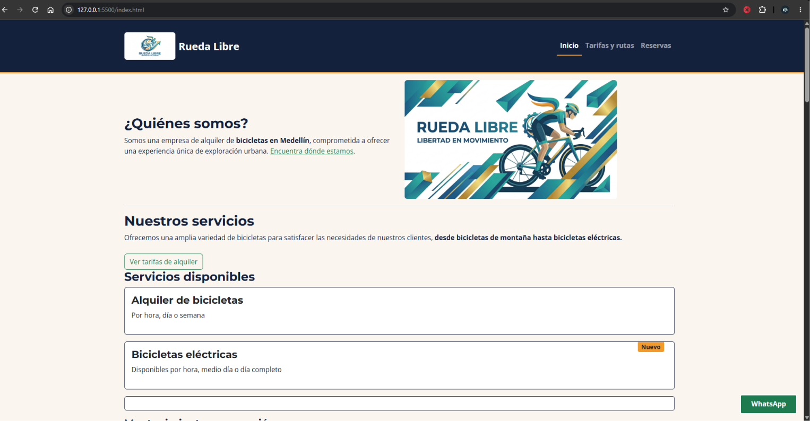
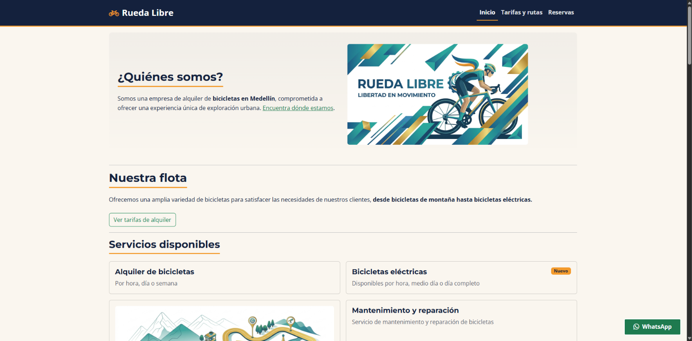
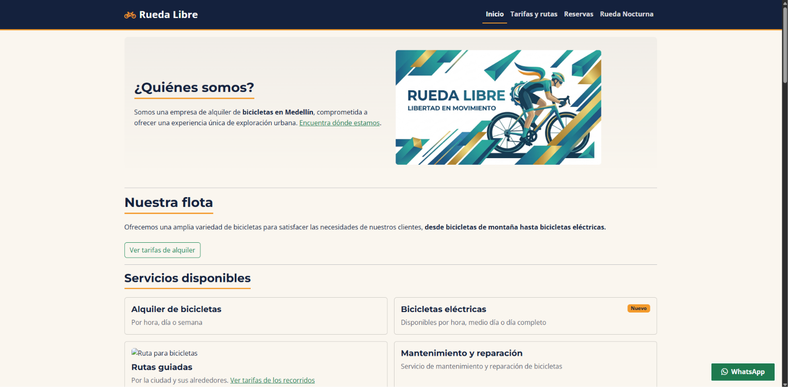
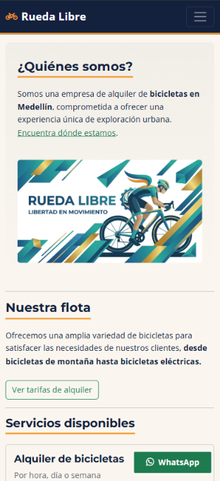
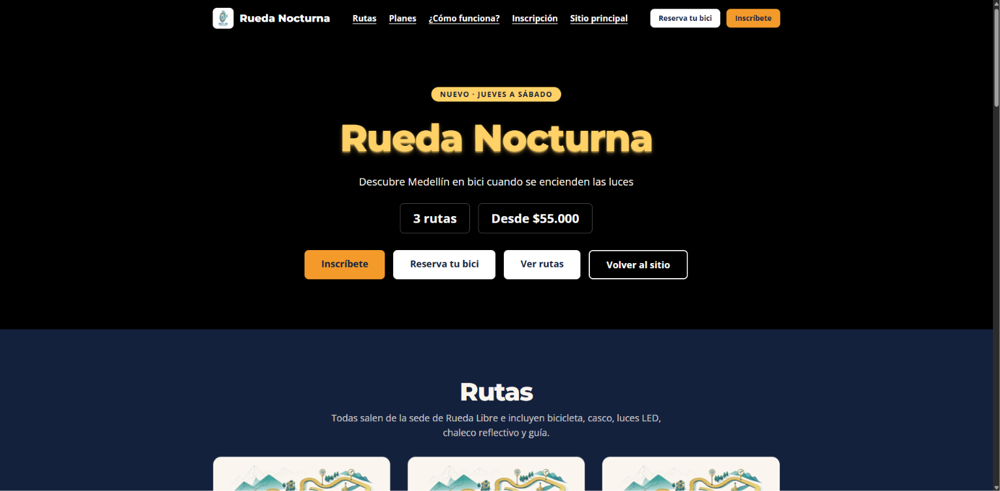

# 🚲 Ecosistema Web Rueda Libre & Rueda Nocturna

Bienvenido a la documentación oficial del ecosistema digital **Rueda Libre (v2.0)** y la campaña nocturna **Rueda Nocturna**. Este proyecto integra una plataforma web de alquiler de bicicletas en Medellín (desarrollada con **Bootstrap 5.3.3**) y una landing page de conversión de alta fidelidad (construida con **Tailwind CSS v4**), unificadas bajo un mismo sistema de diseño, accesibilidad WCAG y navegación fluida sin fricciones.

---

## 🌐 Enlace del Proyecto Publicado

- **Sitio en Producción (GitHub Pages):** [https://samthekiller17.github.io/Rueda-Libre-Proyecto/](https://samthekiller17.github.io/Rueda-Libre-Proyecto/)
- **Landing Rueda Nocturna:** [https://samthekiller17.github.io/Rueda-Libre-Proyecto/nocturna/](https://samthekiller17.github.io/Rueda-Libre-Proyecto/nocturna/)
- **Kit de Componentes UI (Tailwind):** [https://samthekiller17.github.io/Rueda-Libre-Proyecto/nocturna/componentes.html](https://samthekiller17.github.io/Rueda-Libre-Proyecto/nocturna/componentes.html)

---

## 📖 Descripción del Proyecto

El ecosistema digital resuelve la necesidad de conectar dos experiencias complementarias:
1. **Sitio Principal Rueda Libre (v2.0):** Portal institucional para el alquiler de bicicletas urbanas, eléctricas, de montaña y tándem en Medellín, con consulta de tarifas, información de estaciones y reserva formal.
2. **Landing Page Rueda Nocturna:** Campaña de marketing y captación dirigida a ciclistas urbanos que buscan paseos nocturnos guiados por puntos emblemáticos de la ciudad, con rutas detalladas, selector de planes de precios (Individual, Pareja y Grupal) y formulario de inscripción directa.

Ambos productos conviven de forma sincronizada mediante:
- **Navegación cruzada bidireccional:** Acceso inmediato a la landing nocturna desde la navbar y el carrusel de inicio, y retorno al portal principal o reserva de bicicletas desde el encabezado, portada y pie de la landing.
- **Identidad de marca unificada:** Mismos tokens de color (Verde Ruta, Naranja Pedal, Azul Noche, Crema y Gris Asfalto) y tipografías corporativas (*Montserrat* y *Open Sans*).
- **Cero errores 404** en rutas relativas locales y en GitHub Pages.

---

## 📂 Mapa de Páginas y Estructura del Repositorio

```text
Rueda-Libre-Proyecto/
├── index.html                  # Inicio del portal v2.0 (Bootstrap 5.3.3, carrusel, servicios)
├── README.md                   # Documentación técnica y bitácora consolidada
├── bitacora.txt                # Registro cronológico del proceso de desarrollo
├── css/
│   └── styles.css              # Variables CSS de marca (--bs-*), utilidades y personalizaciones
├── img/                        # Recursos gráficos y fotografías de bicicletas
│   ├── Capturas/
│   │   ├── Antes.png           # Captura del sitio previo a v2.0
│   │   └── Despues.png         # Captura del ecosistema consolidado v2.0
│   ├── Icono_Rueda_Libre.jpg
│   ├── Portada.jpg
│   └── Ruta.png
├── Paginas/
│   ├── tarifas.html            # Tablas de precios y paquetes de alquiler
│   └── reservas.html           # Formulario validado con modal de políticas
└── nocturna/                   # Campaña Rueda Nocturna (Tailwind CSS v4)
    ├── index.html              # Landing page completa (rutas, planes, inscripción)
    ├── componentes.html        # Catálogo y pruebas de componentes accesibles
    ├── prototipo.html          # Prototipo inicial de validación
    ├── package.json            # Configuración de compilación con Tailwind CLI
    └── src/
        ├── input.css           # Capas @theme, @layer components y utilidades
        └── output.css          # CSS minificado para producción
```

### Detalle de Páginas:
1. **`index.html` (Inicio):** Navbar colapsable con hamburguesa, carrusel de 4 diapositivas con llamada a la Rueda Nocturna, galería de bicicletas y pie corporativo.
2. **`Paginas/tarifas.html`:** Comparativa clara de precios por hora, día y semana, beneficios incluidos y enlace directo al formulario de reserva.
3. **`Paginas/reservas.html`:** Formulario interactivo con validación Bootstrap `.needs-validation`, alerta contextual para documentos y modal accesible de políticas de alquiler.
4. **`nocturna/index.html`:** Landing page con soporte para modo oscuro (`dark:`), sección interactiva de planes de precios en CSS Grid, acordeón de rutas y formulario accesible con validación nativa.
5. **`nocturna/componentes.html`:** Guía viva de estilos con botones estandarizados (`btn-principal`, `btn-secundario`, `btn-contorno`), inputs y badges de contraste verificado.

---

## 🛠️ Tecnologías Utilizadas

- **HTML5 Semántico:** Estructuración limpia mediante `<header>`, `<nav>`, `<main>`, `<section>`, `<article>`, `<fieldset>`, `<aside>` y `<footer>` sin anidamientos innecesarios.
- **Bootstrap 5.3.3 & Bootstrap Icons 1.11.3:** Utilizado en el sitio base para componentes estructurales (navbar responsiva, carrusel dinámico, modales y validación de formularios).
- **Tailwind CSS v4 (Compilado con CLI):** Utilizado en la landing `nocturna/` mediante `@theme` para sincronización de tokens, utilidades `dark:`, Flexbox y Grid sin dependencias de runtime.
- **CSS3 Moderno:** Variables CSS nativas (`:root`), box model `border-box`, selectores de especificidad calculada y media queries para breakpoints (360px, 768px, 1280px).
- **JavaScript Vanilla:** Scripts livianos de validación de formulario (`needs-validation`), cálculo de días y soporte para componentes interactivos nativos.

---

## ⚖️ Recomendación de Framework (MiniReto 8)

Durante el desarrollo de la versión 2.0 y la integración de la landing page, se realizó un exhaustivo análisis comparativo de rendimiento, mantenibilidad y peso de transferencia entre **Bootstrap 5.3.3** y **Tailwind CSS v4**.

### 1. Métricas de Rendimiento y Tamaño Transferido (Brotli / Gzip)

| Paquete / Archivo | Sin comprimir | Gzip | Brotli | Dependencias JS |
| :--- | :---: | :---: | :---: | :---: |
| **Tailwind CSS (output.css minificado)** | 25,9 KB | 4,8 KB | **4,2 KB** | **0 KB** (Cero JS) |
| **Bootstrap 5.3.3 (CSS CDN)** | 227,3 KB | 30,1 KB | **22,2 KB** | — |
| **Bootstrap 5.3.3 (JS Bundle CDN)** | 78,8 KB | 23,2 KB | **20,7 KB** | Requerido para menú/modal |
| **Bootstrap Icons (CSS + WOFF2)** | 211,2 KB | 140,3 KB | **137,4 KB** | — |

*El sitio v2.0 en Bootstrap transfiere aproximadamente 43 KB comprimidos entre CSS y JS antes de cargar imágenes o fuentes, mientras que la landing en Tailwind transfiere solo 4,2 KB de CSS y cero JavaScript de framework.*

### 2. Tabla Comparativa de Criterios

| Criterio | Bootstrap 5.3.3 | Tailwind CSS v4 |
| :--- | :--- | :--- |
| **Curva de Aprendizaje** | Muy baja y rápida. Componentes completos listos para copiar (navbar, carrusel, modal, accordion). | Curva inicial más empinada. Requiere dominar fundamentos de CSS (box model, flex, grid) y herramientas de compilación (Node.js/CLI). |
| **Personalización de Marca** | Fricción media-alta. Los colores y radios por defecto exigen sobrescribir variables `--bs-*` y reglas CSS específicas (`!important` evitado con especificidad). | Inmediata y natural. Con `@theme` los colores y tipografías se convierten en utilidades nativas (`bg-verde-ruta`, `text-naranja-pedal`). |
| **Modo Oscuro** | Requiere atributos de tema en elementos raíz y configuración de selectores. | Soporte nativo y declarativo elemento por elemento con la variante `dark:`. |
| **Mantenibilidad** | Clases predecibles en el HTML, pero estilos acumulativos en archivos externos que crecen con el tiempo. | Todo se lee directamente en el HTML. Se crearon componentes reutilizables con `@apply` (`btn-principal`, `btn-secundario`, `btn-contorno`) para reducir redundancia. |

### 3. Dictamen y Recomendación Oficial para Rueda Libre
> **Recomendación:** Se recomienda adoptar **Tailwind CSS** para las próximas versiones de todo el ecosistema de Rueda Libre, implementando una **migración progresiva página por página**.

**Razones clave del dictamen:**
1. **Fidelidad y consistencia visual:** La identidad visual de Rueda Libre es fuerte y muy personalizada. En Bootstrap se requirieron más de 300 líneas de ajustes CSS para adaptar el verde corporativo y contrastes; en Tailwind se definió una sola vez en el tema y se aplicó sin conflictos.
2. **Prioridad Móvil (Mobile-First):** Más del 70% del tráfico de reservas y consultas ciclistas ocurre en smartphones bajo redes móviles. Reducir la carga de 43 KB a 4,2 KB acelera drásticamente el *Largest Contentful Paint (LCP)*.
3. **Estrategia de reemplazo para JS:** Al migrar el sitio principal a Tailwind, los componentes dinámicos de Bootstrap pueden reemplazarse de forma nativa: el modal con el elemento HTML5 `<dialog>` accesible, el menú móvil con un simple script de 5 líneas, y el carrusel continuo con una cuadrícula responsiva de tarjetas accesibles (resolviendo los problemas de accesibilidad del carrusel en movimiento automático).

---

## 📸 Evidencia Visual: Antes y Después

A continuación se documenta el salto de calidad estética, semántica y responsiva entre la versión inicial del proyecto y la entrega final consolidada:

### Sitio Previo (v1.0 - Sin framework estructurado)


### Ecosistema Consolidado (v2.0 - Bootstrap + Tailwind Integrados)


### Escritorio


### Celular


### Modo Oscuro


---

## 🎯 Verificación y Accesibilidad (WCAG AA & W3C)

- **Validación W3C HTML5:** Páginas revisadas en el validador oficial del W3C (`Paginas/reservas.html`, `nocturna/index.html` e `index.html`) con **0 errores y 0 advertencias**.
- **Jerarquía Semántica:** Estructura estricta de encabezados (`h1` único por página, seguido de `h2` y `h3` sin saltos de nivel).
- **Contraste de Color:** Todos los textos cumplen la relación mínima de contraste de **4.5:1** requerida por WCAG 2.1 AA (incluyendo textos oscuros sobre fondo claro y modo oscuro).
- **Navegación por Teclado:** Foco visible garantizado en todos los elementos interactivos (`focus-visible:ring-4`), orden lógico del tabulador y sin trampas de teclado.
- **Formularios Accesibles:** Todos los campos cuentan con etiquetas explícitas `<label for="...">`, ayudas contextuales `aria-describedby` y mensajes de error específicos.
- **Diseño Responsivo:** Verificado rigurosamente en resoluciones de **360 px** (celular estrecho, sin scroll horizontal), **768 px** (tableta) y **1280 px** (escritorio).

---

## 💡 Aprendizajes Clave

1. **Box Model & Dimensionamiento:** La aplicación consistente de `box-sizing: border-box` previene desbordamientos inesperados en interfaces responsivas con relleno y bordes.
2. **Especificidad CSS sin `!important`:** Comprender el cálculo de especificidad (IDs, clases, elementos) permitió personalizar componentes de Bootstrap manteniendo una cascada limpia y ordenada.
3. **Flexbox vs. Grid:** Uso de Flexbox para distribuciones unidimensionales con alineaciones variables (navegación, alineación de botones con `justify-between`) y Grid para distribuciones bidimensionales simétricas (sección de planes y cuadrícula de rutas).
4. **Arquitectura de Diseño con Utilidades:** El uso de `@theme` en Tailwind CSS v4 permite sincronizar la paleta de colores y las fuentes en un único punto de verdad, facilitando la creación de modos claros y oscuros coherentes.

---

## 👤 Autor

- **Desarrollador:** Samuel Andrés Patiño Perez — Desarrollador de videojuegos y Estudiante de Riwi.
- **Proyecto:** Rueda Libre v2.0 & Rueda Nocturna
- **Fecha de Entrega:** 14 de Noviembre 2026
- **Licencia:** Proyecto académico y comercial para demostración técnica.
